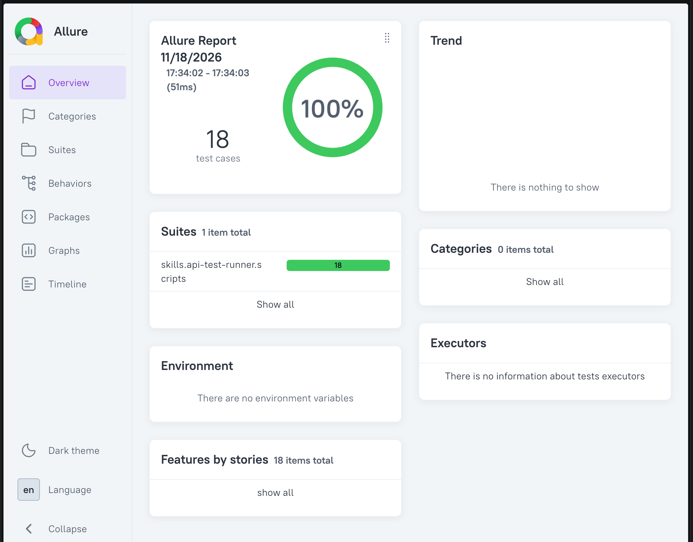

# llm-testcase-service 接口自动化：两种范式对照

> 同一个被测系统，用两种范式各做一遍接口自动化。**两种范式对照 + 人工评审在哪里不可替代**。

- **被测系统**：`llm-testcase-service`（FastAPI，6 个接口，含原 README 漏写的 `GET /` 健康检查）
- **A 线**：手写 pytest 18 条，在独立仓库 `mumu1030/llm-testcase-service`，**不拷代码进来**
- **B 线**：本仓库 6 个 Skill 组成的管线 —— 文档 → 场景 → 配置 → 用例 → 执行 → 报告
- **边界**：被测系统是「靶子」，本仓库是「枪」，两者分开才成立对照

## 目录

1. [双线对照](#1-双线对照)
2. [六环链：六个 Skill 各管什么](#2-六环链六个-skill-各管什么)
3. [证据链：七件产物](#3-证据链七件产物)
4. [报告截图](#4-报告截图)
5. [人工评审拦下了什么](#5-人工评审拦下了什么)
6. [已知工具边界与人的裁决](#6-已知工具边界与人的裁决)
7. [复跑指引](#7-复跑指引)
8. [待补](#8-待补)

---

## 1. 双线对照

| 维度 | A 线：手写 pytest | B 线：Skill 管线 |
| --- | --- | --- |
| 被测接口 | 6 个（含 `GET /`） | 6 个（含 `GET /`） |
| 用例规模 | 18 条手写 pytest | 25 条场景 / 25 条 cases / 18 条启用 |
| 禁用项 | 无 | case `2/3/7/8/15/18/25` 的 `enabled:false`，会真调 DeepSeek |
| 执行结果 | 18 条通过（原仓库） | `18 passed in 0.07s`，failed=0 |
| 报告指标 | 原仓库自管 | 18 passed / 100% / duration=51ms |
| 产物形态 | pytest 代码 | 文档、场景、配置、用例、结果与报告 |
| 谁设计场景 | 人逐条写 | **人设计场景**，Skill 转成可执行格式 |
| 谁裁决预期 | 人 | **人**（见第 5、6 节） |

A 线「手写自动化框架」；B 线「基于Skills使用 AI 工作流驱动自动化，人工确认哪里该被拦住」。两条线打的是同一个靶子。

## 2. 六环链：六个 Skill 各管什么

### 2.1 一条链，六个环节

```
api-doc-generator → api-scenario-generator → api-test-config
  → api-test-generator → api-test-runner → api-test-report
```

**上一步的产物就是下一步的输入**。每个 Skill 只做一件事，边界清楚，任何一步都能停下来人工检查。

> 六件套脚本靠「自身位置」往上数 4 层推项目根，必须留在仓库 `skills/` 里；装到别处会算错路径（早期修过 4 处 `.parent`）。

### 2.2 六个 Skill 各管什么

| # | Skill | 干什么（白话） | 输入 → 产物（本项目实例） |
| --- | --- | --- | --- |
| 1 | `api-doc-generator` | 扫后端源码里的 HTTP 路由定义，统一成接口模型后输出接口文档；支持 Java / Go / Python / Node 四种栈 | `llm-testcase-service` 源码 → `docs/api/api-docs-llm-testcase-service.md`（6 个路由，含 `APIRouter(prefix="/api/v1")` 前缀合并） |
| 2 | `api-scenario-generator` | **测试设计与评审**：先单接口、后串联，覆盖 CRUD + 负向 + 边界值；把重复前置步骤抽到顶层 `dependencies`，再把 JSON 转成评审用 Excel | 接口文档 → `docs/llm_testcase_scenario.json`（权威源）+ `.xlsx`（25 条） |
| 3 | `api-test-config` | 维护 `config/.env`：梳理前置依赖变量、补齐 DB 断言开关模板（默认关）；不生成 `.env.example` | 环境需求 → `config/.env`（被 `.gitignore` 排除，不进库） |
| 4 | `api-test-generator` | 把「人设计的场景」翻译成 runner 能执行的用例：解析步骤为 `steps`、补 `body` / 路径参数 / 断言 / `STEP:` 引用，再导出双 Sheet Excel | 场景 JSON + 接口文档 → `docs/llm_testcase_cases.json` + `.xlsx`（25 条，18 启用） |
| 5 | `api-test-runner` | 读 `cases.json` 用 pytest 参数化执行，支持 `ENV:` / `DEP:` / `STEP:` 三种引用与 case 内多步串联，结果写进 `allure-results/`。**只执行、不改用例**，失败只给修复建议 | `cases.json` → pytest 结果 + `allure-results/`（18 passed） |
| 6 | `api-test-report` | 从 `allure-results/` 生成并打开 Allure 报告；缺 CLI 时只给安装指引、不改环境。`--no-open` 只生成不弹浏览器 | `allure-results/` → `allure-report/`（18 passed / 100% / 51ms） |

三个「本项目特例」，说明流水线不是硬套模板：

- **无登录接口** → 顶层 `dependencies` 保持空数组，不照抄文档里的 `/auth/login` 示例
- **无数据库** → `DB_ASSERT_ENABLED=false`，跳过 `db_assert` 与查表结构脚本
- **会真调 DeepSeek 的 7 条 case**（`2/3/7/8/15/18/25`）设 `enabled:false`，首次执行零成本跑通

> 一句话分工：① 从代码找接口，② 人设计场景，③ 配环境，④ 场景转可执行用例，⑤ 执行，⑥ 出报告。**AI 只产数据与文档，场景设计和预期裁决始终由人做**——这正是第 5、6 节要展开的事。

### 2.3 怎么使用这六个 Skill

**它们没有「安装」**：六件套只留在仓库 `skills/` 下，没有复制到 `~/.workbuddy/skills/`。原因见 2.1 的路径推导——装到别处脚本会算错项目根。所以它们**不会自动触发**，用法是：AI编程工具（比如：codebuddy,cursor）等——新开一个会话、工作目录选仓库根、**点名读某个 `SKILL.md` 让它执行**

**一轮 = 一个 Skill = 一个产物**：每轮只发一条提示语、只认一个交付物，人工验收后再进下一轮；上一步产物就是下一步输入。

| 轮次 | 点名的 SKILL.md | 输入 | 本轮唯一产物 |
| --- | --- | --- | --- |
| ① | `skills/api-doc-generator/SKILL.md` | 被测服务源码路径 | 接口文档 md |
| ② | `skills/api-scenario-generator/SKILL.md` | ① 的接口文档 | `*_scenario.json` + `.xlsx` |
| ③ | `skills/api-test-config/SKILL.md` | 端口 / DB 开关 | `config/.env` |
| ④ | `skills/api-test-generator/SKILL.md` | ② 场景 + ① 文档 | `*_cases.json` + `.xlsx` |
| ⑤ | `skills/api-test-runner/SKILL.md` | ④ cases.json（服务已起） | `allure-results/` |
| ⑥ | `skills/api-test-report/SKILL.md` | ⑤ allure-results | `allure-report/` |

点名句式（可直接粘，只改尖括号里的内容）：

```text
按 skills/<目录名>/SKILL.md 执行 <本轮任务>，输入 <上一步产物>，产出 <本轮产物>。本轮只做这一件事。
```

**四条使用约束**：

1. 文档示例里仍残留旧版 `.cursor/skills/...` 路径，本项目没有 `.cursor` 目录，一律按 `skills/...` 执行；脚本本体已修好，文档不改是为了保「原版可复跑」。（注意 `conn.cursor()` 是数据库游标，不是路径，别误改。）
2. `config/.env` 被 `.gitignore` 排除，clone 后必须自建；否则 runner 会静默回退 `localhost:8080`，打错靶子却不报错。
3. 跑 ⑤ 前先在 **8000** 端口起被测服务（见第 7 节第 1 步）。
4. ⑤ 的 runner 硬规定「失败只给建议、禁止自动改用例」；人工评审的落点在第 5、6 节。

> 本节讲「怎么让 Agent 按 Skill 驱动」；命令级的六步复跑见第 7 节，两者是同一条链的两种视角。

## 3. 证据链：七件产物

| # | 环节 | 产物路径 | 是否进库 |
| --- | --- | --- | --- |
| 1 | 文档扫描 | `docs/api/api-docs-llm-testcase-service.md` | ✅ |
| 2 | 场景 JSON | `docs/llm_testcase_scenario.json` | ✅ |
| 3 | 场景评审表 | `docs/llm_testcase_scenario.xlsx` | ✅ |
| 4 | 可执行用例 JSON | `docs/llm_testcase_cases.json` | ✅ |
| 5 | 可执行用例表 | `docs/llm_testcase_cases.xlsx` | ✅ |
| 6 | 报告截图 | `docs/allure-overview.png` | ✅ |
| 7 | 环境配置 | `config/.env` | ❌ 被排除 |

运行产物（不进库）：`allure-results/`、`allure-report/`。

> 和常规项目相反：这些「生成物」恰恰是作品集的展示价值，所以**提交进版本库**；只有 `config/.env` 例外。
> 也正因为 `allure-report/` 进不了仓库，`docs/allure-overview.png` 是评审者唯一能在仓库里看到的报告视觉证据。

## 4. 报告截图



截图来自 `allure-report/` 的 Overview：18 passed / 100% / 51ms，failed=0，不是白屏或空图表。

## 5. 人工评审拦下了什么

- 场景 7/8 原按文档写 422；读 `models.py` 发现 `platform` / `test_types` 无枚举校验，实际返回 200，于是把预期改为按实现回显。
- 场景 18 文档写 `text/plain` 是笔误；实际 FastAPI 返回 `application/json`，原服务 `r.json()` 得到 Markdown 字符串可证，用例按 JSON 字符串建模而非纯文本。

两条是同一类问题：**接口文档里的描述 ≠ 代码实现**。422 和 `text/plain` 都是「文档说的」，不是「代码做的」。若不在场景阶段拦下，runner 里就是 FAIL——而且会被误判成用例写错。

> 手写的 README 会漏接口（本项目漏了 `GET /`），从代码扫出来的不会漏；但扫出来的文档仍可能写错约束。**两个方向都要人兜底**，这是测试工程师不可替代的证据。

## 6. 已知工具边界与人的裁决

1. scenario 3 条 WARN（2 条服务无 PUT/PATCH、1 条 `GET /` 不合 `/api/v1` 命名）判为误报：前者是服务本就没有更新接口，后者是健康检查路径，不是资源命名遗漏。
2. case 13「数量 N→N+1」降级为可访问性校验：runner 无 `len()`，list 根取不到值，最终用「列表可访问 + 生成后详情可访问」表达新增语义。
3. 导出步骤 `checks` 必须为空：响应体是 JSON 字符串非对象，任何 `$.xxx` 都取 `None`，因此只断言 HTTP 200，内容校验落在同 case 的详情步骤。
4. Suites 显示 `skills.api-test-runner.scripts`、Behaviors 为空：要修需改六件套脚本；为保「clone 即可复跑」选择接受现状。

四条共同点：**工具给出的告警和限制，都要人来判真假、决定接受还是绕开**。这里没有一条是「改脚本让报告变全绿」——六件套一个字节没动，别人 clone 下来照 README 能原样复跑。

## 7. 复跑指引

1. 先在 8000 端口起服务，**不要起在 8080**：

   ```bash
   cd /Users/songmumu/llm-testcase-service && uvicorn main:app --reload
   ```

2. `config/.env` 被 `.gitignore` 排除，clone 后需自建；至少包含：

   ```env
   BASE_URL=http://127.0.0.1:8000
   DB_ASSERT_ENABLED=false
   ```

   `DB_HOST` / `DB_NAME` / `DB_USER` / `DB_PASS` 留空即可，服务是内存库，无 DB 断言。

3. 六步命令按 `skills/` 下各 `SKILL.md` 执行（视角互补：2.3 讲怎么点名 Skill，这里讲命令级复跑）：

   ```bash
   # 文档：见 skills/api-doc-generator/SKILL.md
   # 场景：见 skills/api-scenario-generator/SKILL.md
   python3 skills/api-scenario-generator/scripts/run_scenario_pipeline.py -n llm_testcase

   # 配置：见 skills/api-test-config/SKILL.md，自建 config/.env

   # 用例：见 skills/api-test-generator/SKILL.md，生成后导出 Excel
   python3 skills/api-test-generator/scripts/plan_json_to_excel.py -i docs/llm_testcase_cases.json -o docs/llm_testcase_cases.xlsx

   # 执行：见 skills/api-test-runner/SKILL.md，不传 --base-url
   python3 skills/api-test-runner/scripts/run_tests.py -c docs/llm_testcase_cases.json

   # 报告：见 skills/api-test-report/SKILL.md，--no-open 只生成不弹浏览器
   python3 skills/api-test-report/scripts/serve_report.py --no-open
   ```

4. allure CLI 需自行安装；若缺失，按 `skills/api-test-report/references/install.md` 处理（macOS 可用 `brew install allure`）。

## 8. 待补

- CI 徽章
- 在线报告链接
- Star 数
- 手写与 Skill 管线的性能对比（未做同环境基准，**不编造**）
